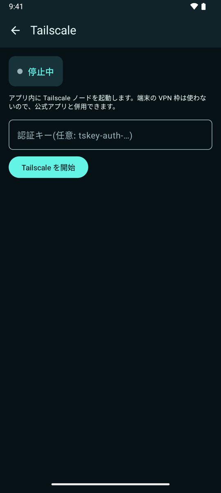

# Acrylterm

English | [日本語](README.md)

Acrylterm is an Android terminal app for connecting to your own Mac or Linux machines over SSH or Mosh. Tailscale can be built into the app, so you can reach your machine at home directly from anywhere.

When the host runs [herdr](docs/herdr-api.md), its tabs, panes, and workspaces become native features of the app. When an AI agent such as Claude Code or Codex is waiting for input, you get a notification and can reply on the spot.

> The app's UI is currently in Japanese. UI labels below are quoted in Japanese with an English gloss.

## Features

### Built-in Tailscale



- Embeds `tsnet` in the app. It does not use the VPN slot, so it works alongside the official app
- Start it from "Tailscale" on the host list and log in. Auth keys also work
- Optional; the app builds without it

### SSH key management


- Generate Ed25519 / RSA keys, import existing keys, copy and share public keys
- Private keys are encrypted with the Android Keystore
- Optionally require biometric authentication on use

### Adding hosts and connecting


- Connect from the host list, which shows connected sessions and how many panes are waiting for input
- **Mosh**: enabled per host. Panes survive network changes, and the app falls back to SSH if Mosh fails

### Tabs / panes / workspaces


The app drives herdr's socket API directly over SSH.

- Split a pane right or down from the "⋮" menu. Layouts split on the host are shown as is. Tap to switch panes, drag a divider to resize
- Create, rename, and close tabs, workspaces, and panes (closing a tab can be undone)
- Open agent tabs as well as shell tabs
- List and open worktrees made by agents on the host, switch herdr sessions
- Falls back to a plain shell when herdr is not installed on the host

### Watching AI agents


- Android notification when an agent is waiting for input
- A reply bar on waiting panes (approve / choices / cancel / compose)
- Preview pane contents from the overview

### Input and scrolling

- **Japanese input**: shows the IME's composing text at the cursor and sends only committed text. The multi-line composer supports conversion and voice input
- **Scrolling**
  - Shell panes fetch history from herdr as you scroll up
  - In TUI apps, fixed header and footer bands are detected and stay pinned while scrolling
- **Text selection**: long-press to select, then copy / paste / select all

### Other

- **Appearance**: color profiles (Cyan Veil / Violet / Frost / Ember / Solar, plus custom), background transparency, wallpaper blur. See [Appearance](#appearance)
- **Lua extensions** (advanced): add macros, automations, and reply suggestions. You can also have an AI CLI on the host write them. See [Lua extensions](#lua-extensions)

## Requirements

- Android 8.0 (API 26) or later
- Host: macOS / Linux reachable over SSH
  - herdr 0.9.3 recommended (0.8 also works). Without it, the app works as a plain shell
  - `mosh-server` if you use Mosh
- Development: Android Studio (tested on macOS)

## Build

1. Open this folder in Android Studio (Gradle sync fetches dependencies)
2. Connect a device and run `app`
   - From the command line: `./gradlew :app:installDebug`
   - Gradle needs Android Studio's bundled JDK (`JAVA_HOME="/Applications/Android Studio.app/Contents/jbr/Contents/Home"`)

At this point you can already connect through the Tailscale app (VPN) on the device. In that case, turn off "Connect via Tailscale" in the host settings.

### Building in Tailscale and Mosh (optional)

```sh
# First install "NDK (Side by side)" from Android Studio > SDK Manager > SDK Tools
./tsbridge/build.sh        # produces app/libs/tsbridge.aar
```

Rebuild the app afterwards and you can log in from the Tailscale screen. The Mosh client lives in the same AAR, so Mosh also needs this step. The first run takes a few minutes to fetch dependencies.

## Host setup

Steps for a Mac:

- **Remote Login**: System Settings > General > Sharing > turn on "Remote Login"
- **Register your public key**: generate a key on the app's SSH keys screen, copy the public key, and append it to `~/.ssh/authorized_keys`
- **herdr** (optional)
  - Update with `herdr update`, then rerun `herdr integration install claude` / `herdr integration install codex`
  - If the herdr server is not running, the app runs `herdr` after login to start it. The command can be changed in the host settings
  - Do not set sshd's `AllowStreamLocalForwarding` to `no` (the default is yes)
- **Mosh** (optional)
  - Install `mosh-server` with `brew install mosh`
  - Allow mosh-server's UDP ports (usually 60001 and up) through the firewall
  - Turn on "マルチタブ / マルチペイン" (multi-tab / multi-pane) and "Mosh" in the host settings

## Usage

### Panes

| Gesture | Action |
|---|---|
| Tap | On the focused pane: click (and show the keyboard). On another pane: focus it |
| Double-tap | Toggle zoom on the focused pane |
| Long-press | Select text. Adjust with the handles, then copy / paste / select all |
| Vertical drag | Scroll (with momentum) |
| Drag a divider | Resize panes |
| Two-finger horizontal swipe | Previous / next tab |
| One-finger horizontal swipe | When showing one pane at a time, move to the neighboring pane (page dots appear at the bottom) |
| Pinch | Change the font size (shared by all panes) |

- While zoomed, or when any pane would be narrower than 40 columns, only the focused pane is shown
- Panes waiting for input show a reply bar along the bottom edge

### Tabs and menu

- Tap the tab bar at the top to switch tabs; long-press a tab to rename it
- Tap "＋" for a new shell tab; long-press it to choose a shell or agent tab
- The tab-count icon opens the tab overview. Tap a card to go there, long-press to enlarge the preview, swipe sideways to close
- The "⋮" menu has sessions, workspaces, tabs, pane splitting, extensions, settings, reconnect, and disconnect
- Disconnecting does not close the tabs or workspaces on the host

### Extra keys

- The extra key bar has ⌨ / ESC / TAB / CTRL / ALT / arrow keys. Keys go to the focused pane
- CTRL / ALT: tap once to apply to the next key, double-tap quickly to HOLD (lock), tap again to release
- Arrow keys: flick up / down / left / right; tap the center for Enter. Hold a direction to repeat, slide back to the center to stop
- The mini key row below has HOME / END / PGUP / PGDN, symbols, and macros (⚡). The "＋" at the end creates an extension
- The keyboard opened with ⌨ is direct input for commands (no prediction or conversion). For Japanese conversion or voice input, use the composer opened from "返信を作成" (compose a reply)

## Appearance


"設定" (Settings) in the "⋮" menu changes the color profile, background transparency, and wallpaper blur.

- Background transparency ranges from 0 to 100%, with presets 0% / 28% (recommended) / 55%. Text, the cursor, and explicit ANSI background colors are not faded
- "この外観を適用" (apply this appearance) saves; going back discards changes
- "背景をぼかす" (blur background) applies to the wallpaper only. Below Android 12, a smoothed gradient approximates the effect

The color design is in [design/cyan-veil/](design/cyan-veil/README.md), and the icon sources are in [design/acrylterm/](design/acrylterm/README.md).

## Lua extensions

Available after enabling advanced features in the settings. Enable them per host to add macros, automations, and reply suggestions.

- Besides scripts made in the app, the app loads `~/.config/acrylterm/*.lua` from the host on connect ("ホストのスクリプトを読み込む", load host scripts, in the host settings)
- While connected, changes on the host are detected and reloaded automatically
- "拡張を作る" (create extension) has an AI CLI on the host (such as Claude Code) write the script
- Bundled example templates (agent-done notification, build-failure alert, git macros, and more) are off by default; switch them on app-wide, or copy one to edit it

See [docs/extensions.md](docs/extensions.md) for details (Japanese) and [app/src/main/assets/ext/API.md](app/src/main/assets/ext/API.md) for the API (English).

## Documentation (Japanese)

- [docs/requirements.md](docs/requirements.md): requirements and decisions
- [docs/architecture.md](docs/architecture.md): architecture
- [docs/herdr-api.md](docs/herdr-api.md): herdr socket API reference
- [docs/extensions.md](docs/extensions.md): Lua extensions

## Development

- `bash scripts/verify.sh`: runs a debug build and writes the log to `.verify/build.log`
- `./gradlew :app:testDebugUnitTest`: unit tests (`app/src/test/`)

Pull requests and translations are welcome. See [CONTRIBUTING.md](CONTRIBUTING.md).

## License

Acrylterm itself is licensed under the [Apache License 2.0](LICENSE). See [NOTICE](NOTICE) for attributions.

## Third-party licenses

The complete list and license texts are in the app under Settings > Licenses (generated from `app/config/`). Main components:

- Termux (terminal-emulator / terminal-view, modified) and the original Terminal Emulator for Android: Apache License 2.0. See [terminal-emulator/NOTICE](terminal-emulator/NOTICE)
- UDEV Gothic (bundled font): SIL Open Font License 1.1
- sshj: Apache License 2.0
- Bouncy Castle: Bouncy Castle Licence (MIT-style)
- LuaJ, slf4j: MIT License
- AndroidX, Jetpack Compose, Kotlin, kotlinx, AboutLibraries: Apache License 2.0
- Tailscale (`tsnet`): BSD 3-Clause License
- wireguard-go (Tailscale fork): MIT License
- gVisor: Apache License 2.0
- golang.org/x/*, Go standard library: BSD 3-Clause License
- mosh-go (modified, `tsbridge/third_party/mosh-go/`): MIT License. Changes are listed in [PATCHES.md](tsbridge/third_party/mosh-go/PATCHES.md)
