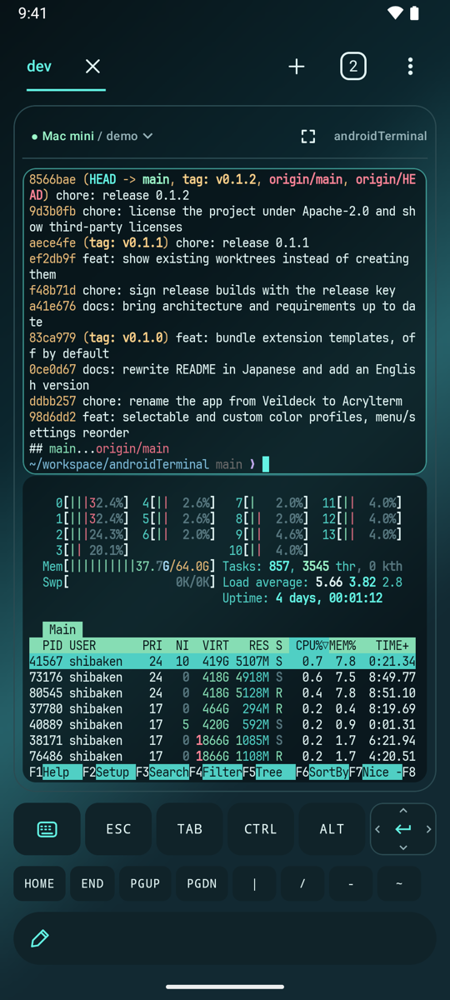
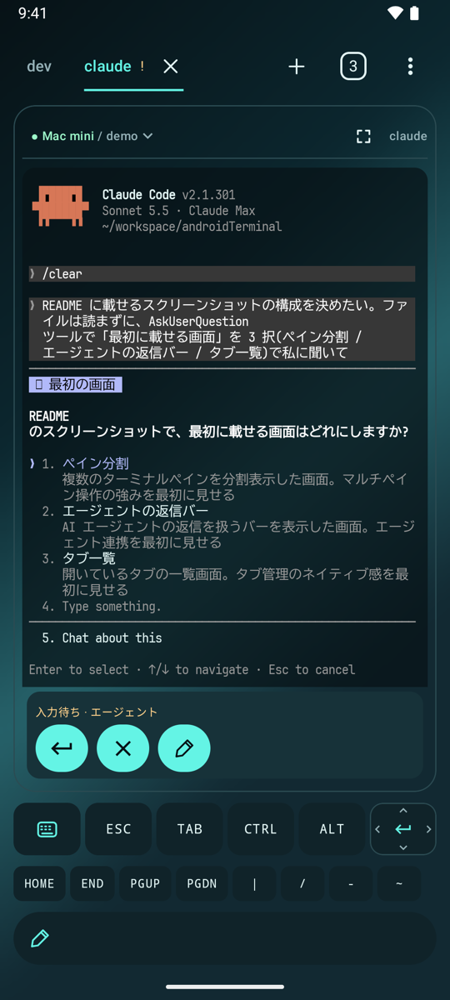
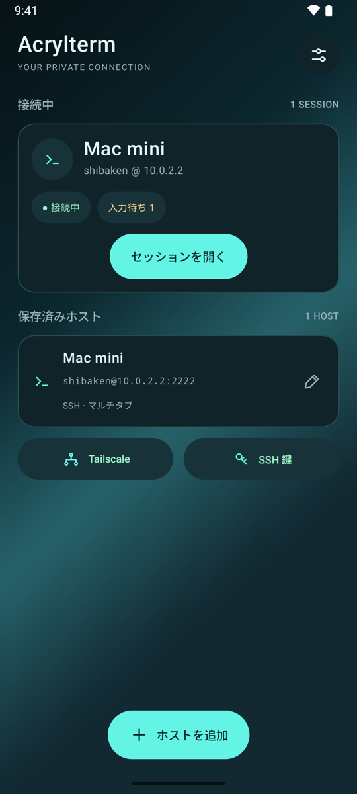
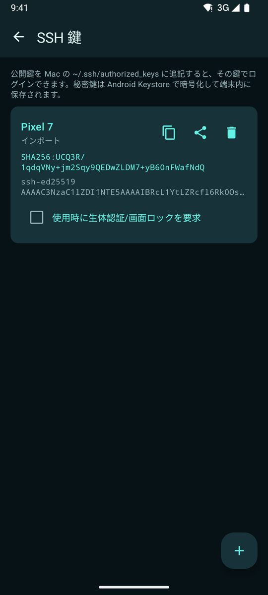
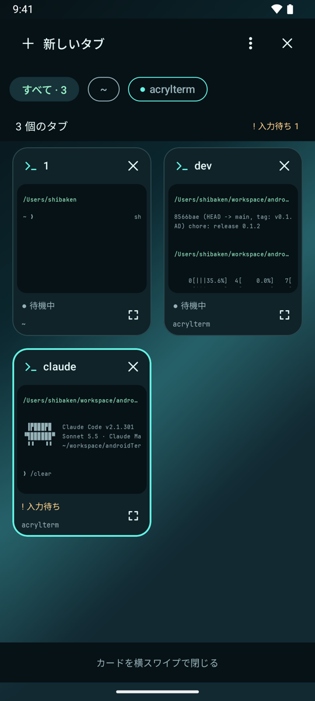
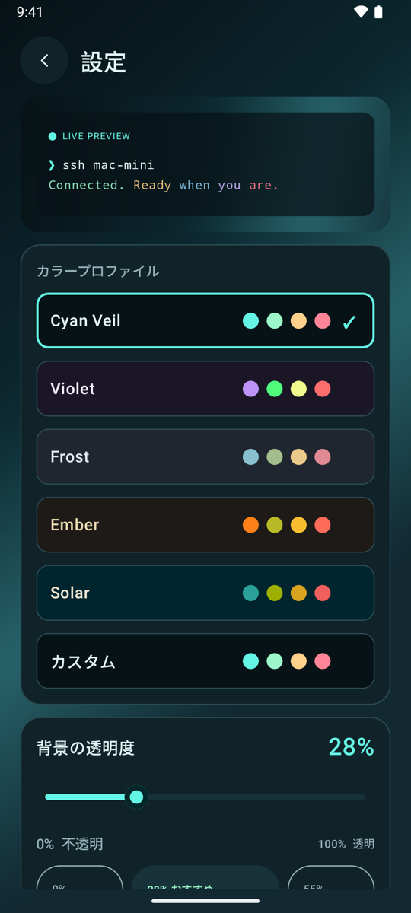

# Acrylterm

[English](README.en.md) | 日本語

Acrylterm（アクリルターム）は、自分の Mac や Linux マシンに SSH / Mosh で接続するための Android ターミナルアプリです。Tailscale をアプリに内蔵できるので、外出先からでも自宅のマシンに直接つながります。

ホスト側で [herdr](docs/herdr-api.md) を使うと、タブやペイン、ワークスペースをアプリの機能として操作できます。Claude Code や Codex などの AI エージェントが入力待ちになると通知され、その場で返信できます。

## 主な機能

### タブ / ペイン / ワークスペース



herdr のソケット API を SSH 経由で直接操作します。

- ペインを右 / 下に分割(「⋮」メニュー)。ホスト側で分割したレイアウトもそのまま表示し、タップで切り替え、区切り線のドラッグで大きさを変更
- タブ・ワークスペース・ペインの作成、名前変更、閉じる操作(タブを閉じたときは取り消し可能)
- シェルのタブに加えて、エージェントのタブを作成
- エージェント等が作った既存ワークツリーの一覧表示・開く、herdr セッションの切り替え
- ホストに herdr が無いときは通常のシェルを開く

<br clear="right">

### AI エージェントの見守り



- エージェントが入力待ちになると Android 通知
- 入力待ちのペインには返信バー(承認 / 選択肢 / キャンセル / 作成)
- 一覧画面でペインの内容をプレビュー

<br clear="right">

### 接続



- ホスト一覧から接続する。接続中のセッションと、入力待ちのペインの数が出る
- **Mosh**:ホストごとに有効化。回線が切り替わってもペインを維持し、失敗時は SSH に自動で戻る
- **Tailscale 内蔵**:`tsnet` をアプリに組み込む。VPN 枠を使わないので、公式アプリと併用できる。後から追加できるオプションで、無くてもビルドできる

<br clear="right">

### SSH 鍵管理



- Ed25519 / RSA の生成、既存鍵のインポート、公開鍵のコピーと共有
- 秘密鍵は Android Keystore で暗号化して保存
- 使用時に生体認証を求める設定も可能

<br clear="right">

### 入力とスクロール

- **日本語入力**:IME の未確定文字列をカーソル位置に表示し、確定した文字列だけを送信。複数行の作成欄では日本語変換と音声入力が使える
- **スクロール**
  - シェルのペインは、上にスクロールすると herdr から履歴を取り寄せて表示
  - TUI アプリでは、上下の固定帯(ヘッダーとフッター)を自動で検出し、スクロール中も固定
- **テキスト選択**:長押しで選択し、コピー / 貼り付け / すべて選択

### その他

- **外観**:色プロファイル(Cyan Veil / Violet / Frost / Ember / Solar とカスタム)、背景の透明度、壁紙のぼかし。詳しくは[外観](#外観)
- **Lua 拡張**(上級者向け):マクロ、自動処理、返信候補を追加。ホストの AI CLI に拡張を書かせることも可能。詳しくは [Lua 拡張](#lua-拡張)

## 動作環境

- Android 8.0(API 26)以上
- 接続先:SSH でログインできる macOS / Linux
  - herdr 0.9.3 を推奨(0.8 系でも動作)。無くても通常のシェルとして使える
  - Mosh を使う場合は `mosh-server`
- 開発:Android Studio(Mac で検証)

## ビルド

1. Android Studio でこのフォルダを開く(Gradle 同期で依存関係が自動で取得される)
2. 実機をつなぎ、`app` を Run
   - コマンドラインの場合は `./gradlew :app:installDebug`
   - Gradle には Android Studio 同梱の JDK(`JAVA_HOME="/Applications/Android Studio.app/Contents/jbr/Contents/Home"`)を使う

この時点で、端末側の Tailscale アプリ(VPN)を使えば接続できます。その場合は、ホスト設定で「Tailscale 経由」をオフにしてください。

### Tailscale と Mosh を内蔵する(任意)

```sh
# 事前に Android Studio > SDK Manager > SDK Tools で「NDK (Side by side)」をインストール
./tsbridge/build.sh        # app/libs/tsbridge.aar を生成
```

生成後にアプリを再ビルドすると、Tailscale 画面からログインできるようになります。Mosh のクライアントも同じ AAR に入っているので、Mosh を使う場合もこの手順が必要です。初回は依存の取得に数分かかります。

## ホスト側の準備

Mac の場合の手順です。

- **リモートログイン**:システム設定 > 一般 > 共有 > 「リモートログイン」をオン
- **公開鍵の登録**:アプリの「SSH 鍵」画面で鍵を生成し、公開鍵をコピーして `~/.ssh/authorized_keys` に追記
- **herdr**(任意)
  - 更新は `herdr update`。更新後は `herdr integration install claude` / `herdr integration install codex` を再実行
  - herdr のサーバーが起動していなくても、ログイン後に `herdr` を自動で実行するので立ち上がる。実行するコマンドはホスト設定で変更できる
  - sshd の `AllowStreamLocalForwarding` を `no` にしないこと(既定は yes)
- **Mosh**(任意)
  - `brew install mosh` で `mosh-server` を入れる
  - ファイアウォールで mosh-server の UDP(通常は 60001 番以降)を許可
  - ホスト設定で「マルチタブ / マルチペイン」と「Mosh」をオン

## 操作

### ペイン

| 操作 | 動作 |
|---|---|
| タップ | フォーカス中のペインならクリック(キーボードも表示)、別のペインならそのペインへ移動 |
| ダブルタップ | フォーカス中のペインのズームを切り替え |
| 長押し | テキストを選択。ハンドルで範囲を調整し、コピー / 貼り付け / すべて選択 |
| 縦ドラッグ | スクロール(慣性あり) |
| 区切り線をドラッグ | ペインの大きさを変更 |
| 2 本指で左右スワイプ | 前 / 次のタブ |
| 1 本指で左右スワイプ | 1 ペインずつ表示しているとき、隣のペインへ移動(下にページの点が出る) |
| ピンチ | 文字サイズを変更(全ペイン共通) |

- どれかのペインの幅が 40 桁を切るときやズーム中は、フォーカス中のペインだけを表示します
- 入力待ちのペインには、下端に返信バーが出ます

### タブとメニュー



- 上部のタブバーをタップしてタブを切り替え、タブを長押しで名前を変更
- 「＋」をタップでシェルのタブ、長押しでシェルまたはエージェントのタブを選んで作成
- タブ数のアイコンからタブ一覧を開く。カードをタップで移動、長押しでプレビューを拡大、横スワイプで閉じる
- 「⋮」メニューから、セッション一覧、ワークスペース一覧、タブ一覧、ペインの分割、拡張、設定、再接続、切断
- 切断しても、ホスト側のタブとワークスペースは閉じません

<br clear="right">

### 補助キー

- 補助キーバーは ⌨ / ESC / TAB / CTRL / ALT / 方向キー。キーはフォーカス中のペインに送られる
- CTRL / ALT は 1 回タップで次の 1 キーに適用、素早く 2 回タップで HOLD(固定)、もう 1 回で解除
- 方向キーは上下左右にフリック、中央をタップで Enter。方向を保つと連続入力、中央へ戻すと停止
- その下のミニキー列には HOME / END / PGUP / PGDN、記号、マクロ(⚡)が並ぶ。末尾の「＋」から拡張を作れる
- ⌨ から開くキーボードはコマンド用の直接入力(予測・変換なし)。日本語変換や音声入力は「返信を作成」の作成欄から使う

## 外観



「⋮」メニューの「設定」で、色プロファイル、背景の透明度、壁紙のぼかしを変えられます。

- 背景の透明度は 0–100% で、プリセットは 0% / 28%(おすすめ) / 55%。文字・カーソル・明示的な ANSI 背景色は薄くならない
- 「この外観を適用」で保存し、戻る操作では変更を破棄する
- 「背景をぼかす」は壁紙だけに適用される。Android 12 未満では、グラデーションをなだらかにして近い効果を出す

配色の設計は [design/cyan-veil/](design/cyan-veil/README.md)、アイコンの原稿は [design/acrylterm/](design/acrylterm/README.md) にあります。

<br clear="right">

## Lua 拡張

設定で上級機能を有効にすると使えます。ホストごとに有効にし、マクロ、自動処理、返信候補を追加できます。

- アプリ内で作ったスクリプトに加えて、ホストの `~/.config/acrylterm/*.lua` を接続時に読み込む(ホスト設定の「ホストのスクリプトを読み込む」)
- 接続中はホスト側の変更を検知して自動で再読込する
- 「拡張を作る」から、ホストの AI CLI(Claude Code など)にスクリプトを書かせられる
- 例になるテンプレート(エージェント完了通知、ビルド失敗通知、git マクロなど)を同梱。既定は off で、アプリ全体でオンにでき、コピーして編集できる

詳細は [docs/extensions.md](docs/extensions.md)、API は [app/src/main/assets/ext/API.md](app/src/main/assets/ext/API.md) にあります。

## ドキュメント

- [docs/requirements.md](docs/requirements.md):要件と決定事項
- [docs/architecture.md](docs/architecture.md):構成
- [docs/herdr-api.md](docs/herdr-api.md):herdr ソケット API のリファレンス
- [docs/extensions.md](docs/extensions.md):Lua 拡張

## 開発

- `bash scripts/verify.sh`:デバッグビルドを実行し、ログを `.verify/build.log` に出力
- `./gradlew :app:testDebugUnitTest`:ユニットテスト(`app/src/test/`)

## ライセンス

Acrylterm 本体は [Apache License 2.0](LICENSE) です。帰属表示は [NOTICE](NOTICE) を参照してください。

## サードパーティのライセンス

完全な一覧とライセンス本文は、アプリの 設定 > ライセンス で確認できます(生成元は `app/config/`)。主なもの:

- Termux(terminal-emulator / terminal-view、改変あり)と元の Terminal Emulator for Android:Apache License 2.0。詳細は [terminal-emulator/NOTICE](terminal-emulator/NOTICE)
- UDEV Gothic(同梱フォント):SIL Open Font License 1.1
- sshj:Apache License 2.0
- Bouncy Castle:Bouncy Castle Licence(MIT 形式)
- LuaJ、slf4j:MIT License
- AndroidX、Jetpack Compose、Kotlin、kotlinx、AboutLibraries:Apache License 2.0
- Tailscale(`tsnet`):BSD 3-Clause License
- wireguard-go(Tailscale fork):MIT License
- gVisor:Apache License 2.0
- golang.org/x/*、Go 標準ライブラリ:BSD 3-Clause License
- mosh-go(改造版、`tsbridge/third_party/mosh-go/`):MIT License。変更点は [PATCHES.md](tsbridge/third_party/mosh-go/PATCHES.md)
